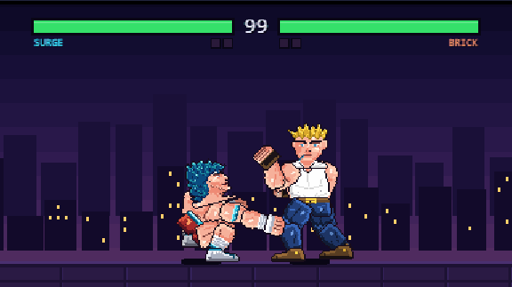
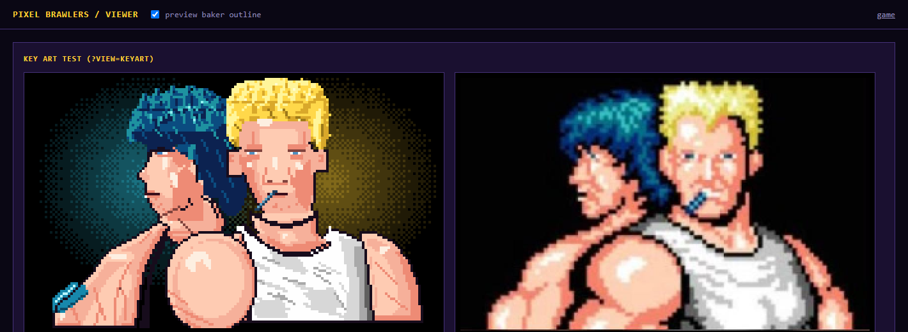

# Pixel Brawlers

An original 2D pixel fighting game for the browser, built with plain JavaScript and Canvas. No build step, no dependencies, no copyrighted assets. **Work in progress:** the engine is being rebuilt in phases (see [docs/ROADMAP.md](docs/ROADMAP.md)). Right now it is a two-fighter versus demo with a temporary menu.



## Run it

Any static server works:

```bash
npx serve .
```

Open the address it prints (for example <http://localhost:3000>). Hosted build: <https://iice257.github.io/pixel-brawlers/>

- `/` is the new engine: a temporary menu (VERSUS 2P, VS CPU (dummy), TRAINING stub), a SURGE/BRICK pick, then a best-of-3 match.
- `/?legacy=1` is the original v0.1 game (story mode, four fighters), kept until the rebuild replaces it.
- QA params for the new engine: `?p1=brick&p2=surge`, `dummy=1`, `rounds=1|3|5`, `match=0` (bare sandbox), `boxes=1`, `panel=1`.
- Tests: `npm test` (engine, input, combat, throws, combos, match flow, FX, and a 300-match soak run).

## Controls

| Action | Player 1 / solo | Player 2 |
| --- | --- | --- |
| Move / crouch / jump | W A S D | Arrow keys |
| Light / heavy punch | U / I | Numpad 4 / 5 (or `[` / `]`) |
| Light / heavy kick | J / K | Numpad 1 / 2 (or `;` / `'`) |
| Block | Space or L (or hold back) | Numpad 0 (or `/`) |
| Throw | O | Numpad 3 (or `.`) |

In the single-player modes you can use either layout (arrows + Z X C V B N also works). Gamepad: X / Y punches, A / B kicks, LB or RB block, LT or RT throw, Start pause.

`Esc` or `P` pause (resume, controls, restart, quit), `F1` key cheat sheet (on for your first 3 matches), `F2` hitboxes, `F3` stats, `F` fullscreen, `R` restart, `Tab` swaps the fighter you control in Training. Every key can be rebound on the Controls screen (keyboard diagram, presets, conflicts shown in red).

Modes: VS CPU (8 difficulty tiers), 2 PLAYERS, TRAINING (dummy stand / crouch / jump / block / CPU, infinite health, boxes, input history), WATCH (CPU vs CPU), CONTROLS, LEGACY.

What is in so far: walk, dash, jump, normals, blocking, throws with tech and quick-rise, chain cancels, combo scaling, juggles, round/match flow with KO and time-up, hit sparks, dust, screen shake and afterimages. What is not: special moves, meter use, more fighters, music, the final front end.

## Sprite viewer

The next-generation art pipeline (rig, baker, pose library, portraits) is developed in a standalone viewer. The playable game at `/` uses the same art through the new engine.



Run `npx serve .` and open `/viewer`:

| View | URL |
|---|---|
| Animation player (scrub, speed, onion skin, hit/hurtboxes, pose tuner, coverage) | `/viewer?view=anim&fighter=surge&anim=idle` |
| Contact sheet (PNG export) | `/viewer?view=contact&fighter=brick` |
| Portraits (1x/2x/4x, HUD crop, beside the reference) | `/viewer?view=portrait&both=1` |
| Key art test | `/viewer?view=keyart` |
| Parts sheet, palettes, reference eyedropper | `/viewer?view=parts`, `?view=palettes` |

Art lives in `src/data/fighters/*.js` (generated by `node tools/gen/emit.mjs`, checked by `node tools/validate-art.mjs`). QA screenshots are in `media/qa/`.

## Project layout

```
index.html        page shell
css/              page styling
src/
  main.js         routing: new engine at /, legacy game at ?legacy=1
  engine/         pure fixed-60Hz sim (fighters, combat, throws, combos, match flow)
  core/           input sampling, input buffer, loop, rng
  data/           fighter art, frame data, animations
  gfx/            rig, baker, pose library, FX
  ui/             fight scene, HUD, temporary menu, QA helpers
  viewer/         sprite viewer modules
  config.js fighters.js render.js scenes.js input.js audio.js   legacy v0.1 game
tests/            node --test suites
viewer.html       sprite viewer page
tools/            art generators, validator, reach and pose checks
docs/             design, roadmap, tuning log, portfolio plan
media/            screenshots, gameplay capture
```

## Roadmap

See [docs/ROADMAP.md](docs/ROADMAP.md). Next up: real sprite sheets, chiptune music, touch controls, more moves.

## Legal

All characters, names, art and code are original. The game is inspired by the feel of classic arcade fighters but uses none of their characters, art, names or audio.

## License

MIT. See [LICENSE](LICENSE).
